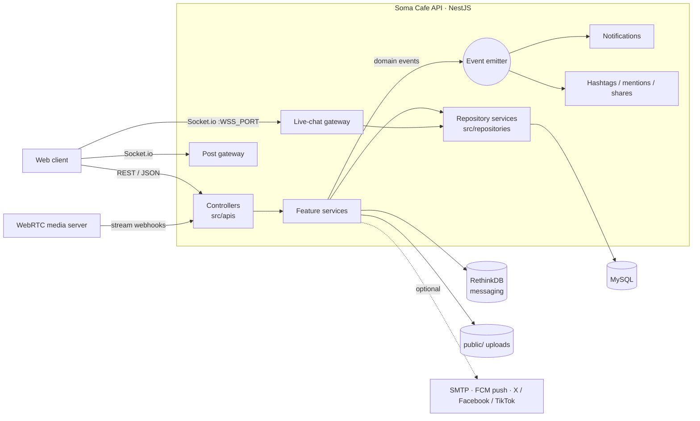

<div align="center">

# Soma Cafe API

**Backend service for Soma Cafe, a social platform for posts, conversations, live streams and live chat.**


[](LICENSE)

</div>

> [!NOTE]
> The hosted Soma Cafe service has been retired. This repository is the cleaned source of its API: it ships with **no user data and no credentials**, and every secret is supplied through environment variables.

---

## Contents

- [Overview](#overview)
- [Features](#features)
- [Architecture](#architecture)
- [Tech stack](#tech-stack)
- [Project structure](#project-structure)
- [Data model](#data-model)
- [Authentication and security](#authentication-and-security)
- [REST API](#rest-api)
- [Real-time API](#real-time-api)
- [Media processing](#media-processing)
- [Getting started](#getting-started)
- [Configuration](#configuration)
- [Production deployment](#production-deployment)
- [Operations](#operations)
- [Testing](#testing)
- [Known issues](#known-issues)
- [License](#license)

## Overview

Soma Cafe API is a modular NestJS monolith that serves the Soma Cafe web client. It handles:

- **Identity:** registration by invite code, login, sessions, password reset
- **Content:** posts, polls, comments, likes, quotes, hashtags, mentions, link previews
- **Social graph:** follows, mutes, blocks
- **Engagement:** notifications, search, bookmarks, custom emoji
- **Communication:** direct messaging and real-time live chat during streams
- **Live video:** stream lifecycle webhooks from a WebRTC media server and video-on-demand posts

It exposes about 140 REST endpoints, documented with Swagger, and two Socket.io gateways.

## Features

| Domain | Capabilities |
| --- | --- |
| **Accounts** | Invite-code sign-up, JWT access + refresh tokens, sessions, profile and avatar editing, profile backgrounds, password reset by email |
| **Posts** | Text, images and video posts, link previews (X, Facebook, TikTok and generic pages), polls with voting and stats, comments, likes, quotes/shares, editing and deletion |
| **Discovery** | Feeds, user/post/hashtag search, who-to-follow suggestions |
| **Social graph** | Follow / unfollow with counters, mute, block, undo mute/block |
| **Notifications** | Likes, shares, mentions, replies, follows, messages, quotes and stream starts. Per-user settings, optional web push. |
| **Messaging** | One-to-one chat rooms and message history in RethinkDB |
| **Live** | Stream records, live and following-live listings, start/end/recording-ready webhooks, automatic stream and VOD posts |
| **Live chat** | Rooms per stream, active users, message edit/delete/like, moderator block, mute and warn, chat history |
| **Moderation** | Post reports, bug reports, contact form |
| **Emoji** | Standard emoji catalogue plus per-user custom emoji uploads |

## Architecture



**Request lifecycle**
1. A controller in `src/apis/` receives the request.
2. Guards authenticate it (`LocalAuthGuard` for login, `JwtAuthGuard` for user routes) and `LoggingInterceptor` gates API access.
3. The feature service applies business rules.
4. Repository services in `src/repositories/` read and write through TypeORM.

**Domain events** decouple side effects from the request path through `@nestjs/event-emitter`:

| Event | Emitted when | Handled by |
| --- | --- | --- |
| `post.new` | A post is created | Hashtag extraction, mention extraction, share tracking |
| `new.follow` | A user follows another | Follow notification |
| `message.new` | A direct message is sent | Message notification |
| `new.notification` | Any notifiable action | Notification store + optional push delivery |

## Tech stack

| Layer | Technology |
| --- | --- |
| Runtime | Node.js, TypeScript 4 |
| Framework | NestJS 8 (Express platform) |
| Persistence | MySQL via TypeORM 0.2 (entities + migrations), RethinkDB for messaging |
| Real-time | Socket.io 4 via `@nestjs/websockets` |
| Auth | Passport (local + JWT), `@nestjs/jwt` |
| Media | sharp (images), fluent-ffmpeg + ffprobe (video) |
| Email | Nodemailer with Handlebars templates |
| HTTP hardening | helmet, frameguard, compression |
| Docs | Swagger / OpenAPI via `@nestjs/swagger` |
| Quality | ESLint, Prettier, Jest, Supertest |

## Project structure

```
src/
├── main.ts                 Bootstrap: body limits, static files, views, helmet, CORS, Swagger
├── app.module.ts           Root module: TypeORM connection and feature modules
├── apis/                   HTTP layer, one module per feature
│   ├── user-api, user-api-v2        accounts, profiles, invites
│   ├── login-api, reset-api         authentication and password reset
│   ├── post-api, post-api-v2        feed, posts, polls, comments, likes
│   ├── follow-api, follow-api-v2    social graph
│   ├── search-api, search-api-v2    search
│   ├── messaging-api                direct messages (RethinkDB)
│   ├── notifications-api            notifications and settings
│   ├── stream-api                   live streams and media-server webhooks
│   ├── mute-, block-, report-, bookmark-, emoji-, status-api
│   └── logging                      API access interceptor
├── repositories/           Data layer: entities, DTOs, repository services per aggregate
├── auth/                   Passport strategies, guards, token issuing
├── chat/                   Live-chat gateway and event codes
├── modules/                Shared: mail, security (password encryption), redis
└── exceptions/             Domain exceptions
migrations/                 TypeORM migrations
views/mail/                 Email templates (welcome, invite, forgot password)
public/                     Static assets; runtime uploads (git-ignored)
test/                       End-to-end test config
```

## Data model

31 MySQL tables, grouped by aggregate:

| Aggregate | Tables |
| --- | --- |
| Users | `users`, `users_session`, `users_tokens`, `users_invites`, `users_emojis`, `reset_token`, `contact_us` |
| Social graph | `users_follow`, `users_mute`, `users_block` |
| Posts | `posts`, `posts_comments`, `posts_likes`, `posts_hashtags`, `posts_mentions`, `posts_link_meta`, `posts_temp_images`, `posts_reports` |
| Polls | `polls`, `polls_option`, `polls_votes` |
| Notifications | `users_notify`, `users_notify_config` |
| Streams and live chat | `streams`, `livechat`, `livechat_users_list`, `livechat_block_list`, `livechat_mute_list`, `livechat_warning_list` |
| Support | `bugs`, `bugs_reports` |

Direct-message rooms and messages are stored in RethinkDB.

## Authentication and security

| Mechanism | Details |
| --- | --- |
| Login | `passport-local` validates credentials, then the API issues a JWT access token (**10 min**) and a refresh token (**30 days**) |
| Protected routes | `JwtAuthGuard` with `passport-jwt` |
| API client gate | `LoggingInterceptor` accepts requests that carry HTTP Basic credentials (`API_AUTH_LOGIN` / `API_AUTH_PASSWORD`) or a JWT |
| Secrets | `JWT_SECRET`, `JWT_REFRESH_SECRET` and `CIPHER_KEY` from the environment |
| HTTP headers | helmet, `X-Frame-Options: DENY`, response compression |
| CORS | Allows the production web origin and `http://localhost:3000` for development |

See [Known issues](#known-issues) for items to address before exposing the service publicly.

## REST API

Interactive OpenAPI docs are served at **`/api`** when the app is running.

| Prefix | Purpose |
| --- | --- |
| `login/v1` | Login, token refresh |
| `user/v1`, `user/v2` | Registration, profiles, invites, settings, who-to-follow |
| `reset/v1` | Password reset |
| `post/v1`, `post/v2` | Feed, posts, comments, likes, polls, link previews |
| `follow/v1`, `follow/v2` | Follow graph |
| `search/v1`, `search/v2` | Users, posts, hashtags |
| `notify/v1` | Notifications and notification settings |
| `messaging/v1` | Chat rooms and messages |
| `stream/v1` | Live and following streams, stream info, `listener` webhook for the media server |
| `mute/v1`, `block/v1`, `report/v1`, `bug/v1` | Moderation and bug reports |
| `bookmark-api`, `emoji-api` | Bookmarks, emoji |
| `status/v1` | Feed polling: count of new posts since a timestamp |

**Stream webhook.** `POST stream/v1/listener` receives `liveStreamStarted`, `liveStreamEnded` and `vodReady` events from the media server. It creates stream posts, ends streams and publishes recordings.

## Real-time API

| Gateway | Port | Transport | Purpose |
| --- | --- | --- | --- |
| Post gateway | `APP_PORT` | Socket.io | Broadcasts `SOCKET_VIDEO_UPLOAD_PROGRESS` during video processing |
| Live-chat gateway | `WSS_PORT` | WebSocket only | Stream chat rooms and moderation |

**Live-chat events**

| Client → server | Server → clients |
| --- | --- |
| `SOCKET_ROOM_CONNECT`, `SOCKET_ROOM_LEAVE` | `SOCKET_ROOM_CONNECTED`, `SOCKET_RESPONSE_ACTIVE_USERS`, `SOCKET_CHAT_HISTORY` |
| `SOCKET_NEW_MESSAGE`, `SOCKET_MESSAGE_EDIT`, `SOCKET_MESSAGE_DELETE` | `SOCKET_NEW_MESSAGE_ARRIVED`, `SOCKET_MESSAGE_EDITED`, `SOCKET_MESSAGE_DELETED` |
| `SOCKET_CHAT_LIKE` | `SOCKET_CHAT_LIKED` |
| `SOCKET_USER_BLOCK`, `SOCKET_USER_MUTE`, `SOCKET_USER_WARNING` | `SOCKET_USER_BLOCKED`, `SOCKET_USER_MUTED`, `SOCKET_USER_WARNED`, plus the block, mute and warned lists |
| | `SOCKET_ALERT`, `SOCKET_RESPONSE_ANY_HASH_TAGS` |

## Media processing

- **Images:** uploads are processed with sharp. Avatars are resized to fit 300 × 300.
- **Video:** ffprobe reads the duration and ffmpeg extracts the first frame as a thumbnail. Progress goes to clients over the post gateway.
- **Storage:** files are written under `public/uploads/` (`img`, `emoji`, `bugs`) and `public/profiles/`, and served as static files. URLs are built from `IMAGES_URL`.
- **Limits:** JSON and form bodies accept up to 512 MB.

## Getting started

### Prerequisites

| Requirement | Notes |
| --- | --- |
| Node.js 16+ and npm | |
| MySQL 5.7+ or MariaDB | Main database |
| RethinkDB | Required for direct messaging (`localhost:28015`) |
| SMTP server | Optional; use a local catcher such as MailHog in development |
| Linux or macOS shell | `start:dev` and `build` use POSIX syntax |

A `docker-compose.yml` is included for MySQL, RethinkDB and Adminer.

### Install and run

```bash
git clone https://github.com/realfeisty85/somacafe_be.git
cd somacafe_be
npm install
cp env.sample .env              # fill in your own values

# create the database named in MYSQL_DATABASE, then:
npm run start:dev               # NODE_ENV=development, watch mode
```

In development, TypeORM `synchronize` builds the schema from the entities. The API listens on `APP_PORT`, with Swagger at `http://localhost:<APP_PORT>/api`.

## Configuration

All configuration is read from `.env` ([`env.sample`](env.sample) lists every key).

| Variable | Required | Purpose |
| --- | :---: | --- |
| `APP_PORT` | ✓ | HTTP, Swagger and post-gateway port |
| `WSS_PORT` | ✓ | Live-chat WebSocket port |
| `MYSQL_HOST`, `MYSQL_PORT`, `MYSQL_USERNAME`, `MYSQL_PASSWORD`, `MYSQL_DATABASE` | ✓ | Main database |
| `CIPHER_KEY` | ✓ | 16-character key for `SecurityService` (AES-128-CBC) |
| `JWT_SECRET`, `JWT_REFRESH_SECRET` | ✓ | Access- and refresh-token signing |
| `API_AUTH_LOGIN`, `API_AUTH_PASSWORD` | ✓ | HTTP Basic credentials for API clients |
| `IMAGES_URL` | ✓ | Public base URL for media and invite links |
| `SMTP_HOST`, `SMTP_PORT`, `SMTP_USER`, `SMTP_PASSWORD` | | Outgoing email |
| `STREAM_API_URL`, `STREAM_RECORDS_FOLDER_PATH` | | Media-server REST API and recordings folder |
| `FCM_SERVER_KEY` | | Web push notifications |
| `FACEBOOK_ACCESS_TOKEN`, `TWITTER_BEARER_TOKEN` | | Rich link previews for Facebook and X |
| `REDIS_HOST`, `REDIS_PORT`, `REDIS_DB` | | Redis cache (module wiring currently disabled) |
| `NODE_ENV` | | `development` enables schema synchronize |

Optional integrations stay inactive when their variables are empty.

## Production deployment

```bash
npm ci
npm run build                     # compiles to dist/
NODE_ENV=production npm run typeorm:run-migrations
NODE_ENV=production npm run start:prod   # node dist/main
```

Recommended setup:

- **Process manager.** Run `dist/main.js` under systemd or PM2 with restart on failure. Load `.env` from a secrets store, not from the repository.
- **Reverse proxy.** Put Nginx (or similar) in front for TLS. Proxy `APP_PORT` for REST and Socket.io, and `WSS_PORT` for live chat, with WebSocket upgrade headers enabled.
- **Schema.** Keep `NODE_ENV=production` so `synchronize` stays off, and apply changes only through migrations.
- **Persistent storage.** Mount `public/uploads` and `public/profiles` on a persistent volume, or serve them from object storage, and point `IMAGES_URL` at them.
- **Body size.** Match the proxy's upload limit (for example `client_max_body_size`) to the app's 512 MB limit, or lower both.
- **Databases.** Run managed or replicated MySQL and RethinkDB with scheduled backups.

## Operations

| Task | Command |
| --- | --- |
| Create a migration | `npm run typeorm:create-migration -- -n <Name>` |
| Apply migrations | `npm run typeorm:run-migrations` |
| Lint / format | `npm run lint` · `npm run format` |
| Production start | `npm run start:prod` |

- **Logs** go to stdout and stderr. Collect them with your process manager or log shipper.
- **Backups.** Take database backups with `mysqldump` and keep them outside the repository. `.gitignore` blocks `*.sql`, `*.dump` and archives.
- **Health checks.** There is no dedicated health endpoint yet. Probe the Swagger page (`/api`) or add one before relying on load-balancer checks.

## Testing

```bash
npm run test          # unit tests (Jest)
npm run test:e2e      # end-to-end tests (Supertest)
npm run test:cov      # coverage report → coverage/
```

Most existing spec files are generated scaffolding. Meaningful unit and e2e coverage is still to be written.

## Known issues

| Area | Issue |
| --- | --- |
| Availability | `LoggingInterceptor` calls `process.exit(1)` when a request has neither the Basic credentials nor a JWT, so one unauthenticated request stops the server |
| Security | Passwords use reversible AES encryption rather than a one-way hash (bcrypt or argon2) |
| Configuration | The RethinkDB connection is hardcoded to `localhost:28015` / db `test` in `messaging-api/rethinkdb.provider.ts` |
| Configuration | CORS origins are hardcoded in `main.ts` and the gateways |
| Caching | The Redis cache module is commented out |
| API design | Several features have parallel v1 and v2 modules from an in-progress rewrite |
| Data | No seed or fixture data is included |
| Scope | The web client is maintained separately and is not part of this repository |

## License

Released under the [MIT License](LICENSE). Copyright (c) 2021-2026 Soma Cafe.
